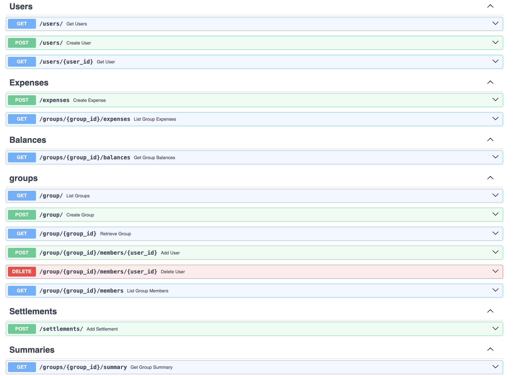
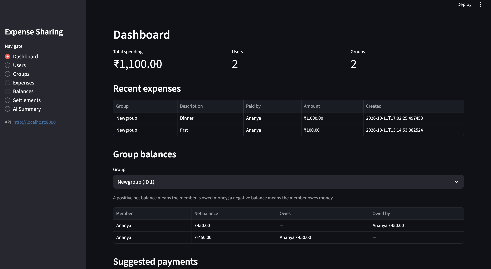
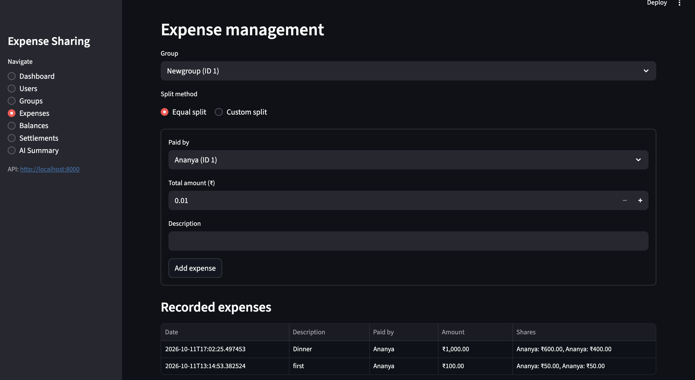
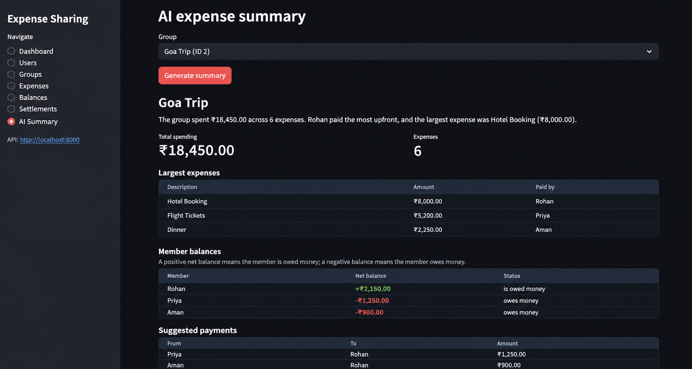

# Expense Sharing Service

A Splitwise-inspired expense-sharing application built using FastAPI, SQLAlchemy, SQLite, and Streamlit. Supports group expenses, equal and custom splits, balance calculation, settlements, and AI-powered expense summaries using Google Gemini.

## Features

- User and group management
- Equal and custom expense splitting
- Group expense history
- Balance calculation and suggested payments
- Settlement recording
- AI-powered expense summaries using Gemini
- Input validation and automated tests

## Requirements

- Python 3.10+
- Google Gemini API key for AI summaries

## Tech Stack

- **Backend:** FastAPI, Python, Pydantic
- **Database:** SQLite, SQLAlchemy
- **Frontend:** Streamlit
- **AI:** Google Gemini API
- **Testing:** Pytest, HTTPX

## Architecture

```text
Streamlit Frontend
        |
      HTTPX
        |
   FastAPI Routers
        |
  Pydantic Schemas
        |
    Service Layer
        |
   SQLAlchemy ORM
        |
      SQLite

Summary Service ---> Gemini API
```

The backend handles validation, financial calculations, and database operations. Streamlit communicates with FastAPI, while Gemini generates natural-language summaries from backend-calculated statistics.

## Run Locally

### 1. Clone the repository

```bash
git clone https://github.com/ananyaprabhakarm/Decentro-Assignment.git
cd Decentro-Assignment
```

### 2. Create a virtual environment

```bash
python -m venv .venv
source .venv/bin/activate
```

For Windows PowerShell:

```powershell
.venv\Scripts\Activate.ps1
```

### 3. Install dependencies

```bash
pip install -r requirements.txt
```

### 4. Configure environment variables

Configure the following variables in your environment:

```env
GEMINI_API_KEY=your_gemini_api_key
API_BASE_URL=http://localhost:8000
```

Keep your actual API key private. A `.env` file requires an environment-variable loader to be loaded automatically.

### 5. Start the backend

```bash
uvicorn app.main:app --reload
```

API: <http://127.0.0.1:8000>

Interactive API documentation: <http://127.0.0.1:8000/docs>

### 6. Start the frontend

Open a second terminal, activate the virtual environment, and run:

```bash
streamlit run streamlit_app.py
```

### 7. Run tests

```bash
pytest -v
```

## Database Design

| Table           | Purpose                                 |
| --------------- | --------------------------------------- |
| `users`         | User details and unique email addresses |
| `groups`        | Expense-sharing groups                  |
| `group_members` | Group membership and membership history |
| `expenses`      | Expense amount, payer, and description  |
| `expenseSplits` | Individual expense allocations          |
| `settlements`   | Payments between group members          |

Users and groups have a many-to-many relationship through `group_members`. Expenses and their individual splits are stored separately to support equal and custom allocations.

## Balance Calculation

Net balance is calculated as:

**Amount paid − Allocated expense shares + Settlements paid − Settlements received**

- Positive balance: the member is owed money.
- Negative balance: the member owes money.

The backend calculates suggested payments by matching debtors with creditors. Settlements affect subsequent balances without modifying original expense records.

## Assumptions and Design Decisions

- Only active group members can participate in new expenses.
- Equal splits preserve the total amount to the nearest paisa.
- Custom split amounts must be positive and sum exactly to the expense total.
- Memberships are deactivated rather than deleted to preserve historical activity.
- `Decimal` and SQLAlchemy `Numeric` are used for monetary calculations.
- The backend is the source of truth for financial figures; Gemini generates textual summaries.
- The current application does not implement full authentication or authorization.

## Screenshots

### 1. FastAPI Swagger Documentation

Interactive API documentation for exploring and testing the available endpoints.



### 2. Streamlit Dashboard

Overview of group expenses, spending statistics, and balances.



### 3. User and Group Management

Creating users and groups and managing group memberships through the UI.



### 4. AI-Powered Expense Summary

Gemini-generated summaries with spending statistics, largest expenses, and member balances.



## Testing

Run `pytest -v` to execute the automated test suite. Tests use an isolated database, and external Gemini calls are mocked where applicable.

## Future Improvements

- Authentication and group-level authorization
- PostgreSQL support and database migrations
- Pagination, filtering, and query optimization
- Improved transaction and concurrency handling
- Enhanced analytics, logging, and monitoring

## Additional Documentation

- [Setup Instructions](setup_instructions.md)
- [API Documentation](api_documentation.md)
- [Database Schema](database_schema.md)

## Repository

[GitHub Repository](https://github.com/ananyaprabhakarm/Decentro-Assignment)
